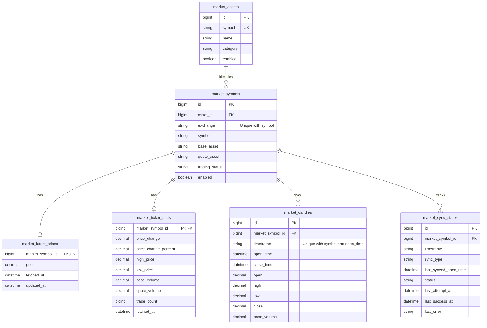

# Crypto Decision Lab - Phase 1

This document records the Phase 1 foundation. Later user-requested extensions are documented in [Jev integration](jev-integration.md) and [Trading Knowledge Engine](trading-knowledge-engine.md).

## Phạm vi

Ứng dụng cá nhân thu thập dữ liệu Binance Spot và cung cấp REST API cho phân tích sau này. Phase 1 chưa có Jev, tín hiệu giao dịch, giao dịch thật, backtesting, paper trading hoặc dashboard Next.js.

## Kiến trúc và module

Phoenix modular monolith nằm trong `apps/api`; `apps/web` có bảng giá theo yêu cầu để quan sát dữ liệu; dashboard đầy đủ vẫn dành cho Phase 4. Xem [thiết kế bảng giá](market-monitor.md). PostgreSQL local được cấu hình trong `infra`. HTTP adapter chỉ giao tiếp với Binance; context `CryptoDecisionLab.MarketData` sở hữu nghiệp vụ và persistence. Controller và worker gọi context, không triển khai nghiệp vụ.

Các module đã triển khai:

- `CryptoDecisionLab.MarketData`: public context cho đọc và đồng bộ dữ liệu.
- `MarketData.Asset`, `Symbol`, `LatestPrice`, `TickerStats`, `Candle`, `SyncState`: Ecto schemas.
- `MarketData.Binance`: HTTP adapter, parsing và chính sách lỗi upstream.
- `MarketData.Sync`: symbol, snapshot và lịch sử; ghi dữ liệu idempotent.
- `MarketData.Poller`: supervised process cho lịch 30 giây, monotonic clock và chống overlap.
- `MarketData.SyncWorker`: Oban worker gọi service đồng bộ.
- `MarketData.Integrity`: kiểm tra khoảng trống và tổng hợp candle.
- `CryptoDecisionLabWeb.MarketController`, `Response`: REST boundary, bao gồm health và sync status.

Các context TechnicalAnalysis, Decisions, Backtesting và PaperTrading chỉ bổ sung ở giai đoạn tương ứng.

## ERD dự kiến

ERD thể hiện quan hệ và field chính. Migration đã bổ sung quote volume, trade count, taker buy volumes và timestamps đầy đủ theo `AGENTS.md`. Dùng NUMERIC không ép float, UTC timestamps, FK, unique và check constraints. Giá mới nhất và thống kê 24h chỉ giữ một snapshot; không tạo tick history.

## Thiết kế đồng bộ

1. Seed 32 asset theo `AGENTS.md`; dùng exchangeInfo để tạo mapping Spot/USDT có thật. Asset thiếu cặp vẫn được giữ và có trạng thái không khả dụng.
2. Metadata mỗi ngày; snapshot giá mỗi 30 giây; rolling statistics mỗi 5 phút; candle sau khi đóng; integrity mỗi ngày.
3. Oban xử lý công việc bền vững. Poller dùng monotonic deadline và không thực thi request chồng lấn. Multi-node cần database coordination để chỉ một collector có hiệu lực.
4. Backfill 1H tối đa 3 năm, tôn trọng ngày niêm yết. Batch theo giới hạn API đã xác minh; ghi candle và checkpoint cùng transaction; resume từ checkpoint, overlap gần nhất khi incremental sync.
5. Chỉ nhận candle đúng cấu trúc, OHLC hợp lệ và đã đóng theo clock đáng tin cậy với safety delay. Không tạo candle giả khi thiếu dữ liệu.
6. Conflict policy: bản ghi candle hoàn tất có cùng khóa được cập nhật bằng dữ liệu hợp lệ vừa lấy; snapshot chỉ cập nhật khi fetched_at không cũ hơn dữ liệu đang lưu. Ghi rõ correction trong logs.
7. Gap detection kiểm tra lưới giờ UTC trong khoảng dữ liệu có thật; gap repair có cursor riêng để không bỏ qua khoảng trống trước checkpoint mới nhất.
8. Tổng hợp 4H/1D chỉ khi đủ 4/24 candle 1H liên tiếp và cùng ranh giới UTC; open đầu, high lớn nhất, low nhỏ nhất, close cuối, cộng volume/trade count.
9. HTTP request có timeout, bounded retries với backoff/jitter, theo dõi weight; 429 tôn trọng Retry-After, 418 dừng trong thời gian ban. Cooldown phải dùng chung giữa các job/node có cùng collector.

## REST contracts

Phase 1 dùng prefix `/api`; thay đổi không tương thích sau này dùng `/api/v2`. Decimal trả dưới dạng chuỗi; timestamp ISO 8601 UTC. Response thành công dùng `{data, meta}`; lỗi dùng `{error: {code, message}}`. Không đưa upstream payload, secret hoặc stack trace vào lỗi public.

| Endpoint                             | Contract                                                                                                                                                                           |
| ------------------------------------ | ---------------------------------------------------------------------------------------------------------------------------------------------------------------------------------- | --- | -------------------------------------------------------------------------------------------------------------------------------------------------------------------------------- |
| `GET /api/markets`                   | Danh mục asset, symbol được xác minh, latest price, 24h stats; `page` >= 1, `page_size` 1–100, mặc định 32. Asset chưa có symbol vẫn xuất hiện với dữ liệu null và status rõ ràng. |
| `GET /api/markets/:symbol`           | Binance symbol được xác minh, ví dụ BTCUSDT; snapshot và freshness; không tìm thấy trả 404.                                                                                        |
| `GET /api/markets/:symbol/candles`   | `timeframe=1h                                                                                                                                                                      | 4h  | 1d`, `from`, `to`UTC,`limit` 1–1000; mặc định 1h và 100 candle gần nhất, thứ tự tăng dần. Chặn khoảng truy vấn quá lớn. Tổng hợp thiếu candle trả lỗi dữ liệu thiếu có cấu trúc. |
| `GET /api/health`                    | Kiểm tra ứng dụng và DB; DB không sẵn sàng trả 503.                                                                                                                                |
| `GET /api/system/market-data-status` | Last success/attempt, freshness, trạng thái backfill, gap count, lỗi đã lọc và tình trạng collector.                                                                               |

`meta` thể hiện thời điểm tạo response, thời điểm lấy dữ liệu, trạng thái stale/missing và pagination khi áp dụng. Giá thiếu là null; không dùng 0. Input sai trả 400; tài nguyên thiếu trả 404; phụ thuộc không sẵn sàng trả 503. Chỉ public read API; quản lý sync chạy qua backend/Mix, không mở endpoint mutation không bảo vệ.

## Kế hoạch Phase 1 và nghiệm thu

Tiến độ triển khai được ghi bên dưới. Kết quả chạy cụ thể và giới hạn môi trường xem [verification.md](verification.md); contracts chi tiết xem [api.md](api.md).

- [x] Khởi tạo Phoenix API, cấu hình môi trường và Compose; xác minh DB health trên PostgreSQL tạm. Chưa chạy Compose do thiếu Docker.
- [x] Migrations, schemas, constraints và seed 32 asset; test uniqueness/Decimal/validation bằng DB test riêng.
- [x] Binance adapter; xác minh schema thực tế và test lỗi, batching, rate limits, retries bằng fixtures.
- [x] Symbol sync và snapshots; test missing symbols và stale snapshot protection.
- [x] Backfill, resume, incremental sync và integrity; test closed candles, duplicate, gaps và aggregation.
- [x] Oban schedules và 30-second poller; test chống overlap, cooldown và coordination giữa node.
- [x] REST controllers và contracts; test JSON, pagination, bounds, freshness và errors.
- [x] Chạy formatter, compiler và tests; chạy smoke sync thực nếu môi trường cho phép.
- [x] README setup/migration/manual sync/test/troubleshooting; báo các hạn chế chưa kiểm chứng.

Phase 1 chỉ hoàn thành khi tất cả tiêu chí trong mục H của `AGENTS.md` được chứng minh bằng kiểm tra thực tế. Thiếu Docker, DB hoặc mạng phải được báo rõ; mock không chứng minh upstream hoạt động.

## Quyết định triển khai

- Dùng monorepo và modular monolith để giữ chi phí vận hành thấp.
- Lưu 1H canonical, tổng hợp timeframe lớn hơn khi đọc; không partition hay thêm kho dữ liệu khác trước khi đo hiệu suất.
- Chưa khởi tạo dashboard hoặc tích hợp AI trong Phase 1.
- Giữ các quy tắc frontend hiện có trong `AGENTS.md`, giới hạn phạm vi `apps/web` và bổ sung Zod tại HTTP response boundary.

Chi tiết thay đổi so với thiết kế ban đầu: thêm `market_collector_states` cho coordination/cooldown/weight; ticker có `data_at`; sync state có `range_start` và `missing_count`. Những bảng Oban không nằm trong ERD nghiệp vụ. Xem [synchronization.md](synchronization.md) về transaction lock, giới hạn vận hành và dependency versions.

Tài liệu upstream đã đối chiếu: [Binance Spot REST](https://developers.binance.com/en/docs/products/spot/rest-api), [Binance market-data-only](https://github.com/binance/binance-spot-api-docs/blob/master/faqs/market_data_only.md), [Phoenix trên Hex](https://hex.pm/packages/phoenix).
